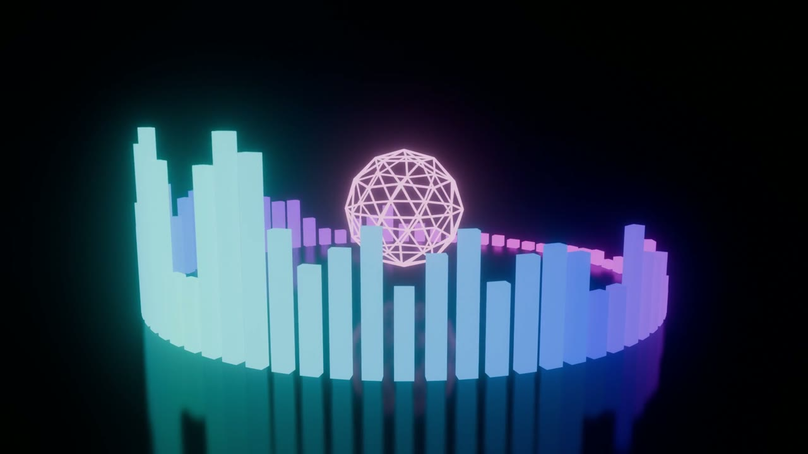

# 3D Music Visualizer for Blender

A circular 3D equalizer that dances to your song: 72 glowing bars, a core that pulses with the bass,
a mirror floor and a camera slowly orbiting the scene. No modeling, no Python knowledge – pick a song and render.



Tested on **Blender 5.2** (works on Windows, macOS and Linux).

## Files

| File | What it does |
| --- | --- |
| [`equalizer_3d.py`](equalizer_3d.py) | Analyzes your song and builds the animated scene. |
| [`join_frames.py`](join_frames.py) | Joins the rendered PNG frames into an MP4 video with the music. |

## How to use

1. Download both scripts (click a file → **Download raw file**).
2. Open Blender and click the **Scripting** tab.
3. In the Text Editor click **Open** and pick `equalizer_3d.py`.
4. Click **Run Script** (▶) or press **Alt+P**. A file browser opens – pick your song
   (MP3, WAV, FLAC, OGG or M4A) and click **Use this song**.
5. Optional preview: **Layout** tab → look through the camera (Numpad 0) → Viewport Shading **Rendered** → **Space**.
6. **Render → Render Animation** (Ctrl+F12). Frames are saved as PNG in `equalizer_frames` next to your song.
   If Blender crashes, press Ctrl+F12 again – finished frames are skipped.
7. In the same Blender file open `join_frames.py` and click **Run Script**. Nothing to type – it remembers
   the song and the frames folder. The MP4 appears next to the frames folder.

Prefer typing the path? Set `AUDIO_PATH = r"C:\Users\me\Music\song.mp3"` at the top of `equalizer_3d.py`
and the file browser is skipped.

## Change the look

Edit the **LOOK & FEEL** section at the top of `equalizer_3d.py` and run it again:

| Setting | Meaning |
| --- | --- |
| `HUE_A`, `HUE_B` | Color range (0–1 hue), default teal → magenta |
| `BANDS` | Frequency bands (the ring shows twice as many bars, mirrored) |
| `RADIUS`, `MAX_HEIGHT` | Ring size and maximum bar height |
| `ATTACK`, `RELEASE` | How fast bars rise and fall (0–1) |
| `ENGINE` | `"EEVEE"` (fast) or `"CYCLES"` (prettier, much slower) |
| `RESOLUTION`, `FPS` | Output size and frame rate |
| `OUTPUT_MODE` | `"PNG"` frames (safe, recommended) or `"MP4"` directly (no join step, but a crash loses the render) |

## Command line

```
blender -b -P equalizer_3d.py -- /path/to/song.mp3
```
